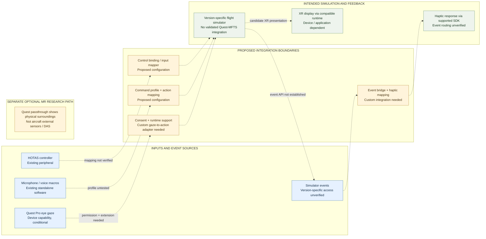

# Quest-MFTS — Figure A: Evidence-labeled multimodal simulation architecture

**Revision:** Visual enhancement Phase A (2026-10-21)  
**Classification:** Proposed systems architecture; **not an implemented XR system**  
**Author:** Joseph Ribal Nasr, Independent Researcher  
**Scope:** Main Quest-MFTS technical report. This figure elaborates the existing conceptual architecture without adding functionality or claiming novel hardware.

## Editable architecture diagram

**Legend:** boxes identify separately available components or intended roles. Every dashed arrow is a **proposed or unverified Quest-MFTS interface**, not an installed or benchmarked connection. Paths shown are alternative or conditional; the diagram is not an as-built wiring schematic. In particular, Quest 3 has **no native eye tracker**; head direction is not eye gaze. A supported Quest Pro gaze path would require consent, runtime extension availability, and an application-side adapter.

## Figure reading notes

1. **Physical controls:** Commercial PC HOTAS devices can provide input, but the simulator-specific mapping, conflicts, and driver versions are not established for Quest-MFTS.
2. **Speech:** Standalone voice utilities can issue command macros. The project has not supplied a validated simulator command profile.
3. **Eye tracking:** Quest Pro eye gaze is conditional on authorization and supported APIs. The OpenXR extension requires positive runtime capability reporting; this does not itself implement gaze-to-command integration.
4. **Simulated state:** The selected simulator/aircraft version must expose commands and events before an adapter could connect input and feedback.
5. **Haptics:** A bHaptics development SDK is available, but translating simulator events into device cues requires a separate, tested event mapping.
6. **Presentation:** PCVR presentation and a separate native passthrough application are distinct paths. Passthrough depicts the user's real room; it is not an aircraft Distributed Aperture System.

## Source and evidence boundary

- Quest-MFTS original architecture: [README.md](README.md), [index.html](index.html), [research.html](research.html).
- Claim classification: [RESEARCH_QUALIFICATION.md](RESEARCH_QUALIFICATION.md) and [PHASE_1_SOURCE_AUDIT.md](PHASE_1_SOURCE_AUDIT.md).
- Source and prior-art register: [PHASE_2_TECHNICAL_PRIOR_ART.md](PHASE_2_TECHNICAL_PRIOR_ART.md).
- Khronos OpenXR gaze capability: https://registry.khronos.org/OpenXR/specs/1.1/man/html/XrSystemEyeGazeInteractionPropertiesEXT.html
- bHaptics SDK event integration: https://docs.bhaptics.com/sdk/

**Verification limit:** This documentation was authored and its Mermaid source inspected. No consumer headset, voice profile, flight simulator, simulator event bridge, or haptic device was run or tested for this figure. No publication approval or Zenodo upload has occurred.
