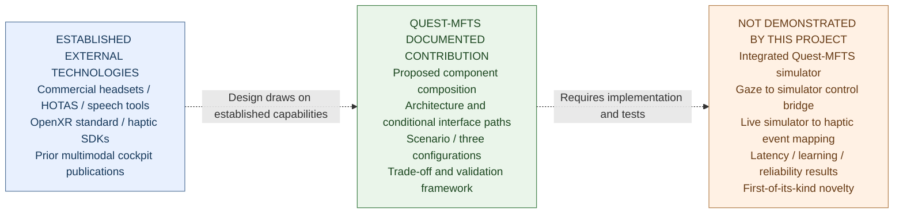

# Quest-MFTS — Enhancement Phase 5: Contribution and Evidence Map

**Author:** Joseph Ribal Nasr | Independent Researcher  
**Status:** DOCUMENTED DESIGN; research novelty and integrated runtime not established  
**Purpose:** A visually legible distinction between existing technology, this project's actual documented contribution, and unverified outcomes.

## Figure 2 — Three evidence layers

**Caption:** Three evidence layers in Quest-MFTS. Dashed links mark an intellectual design dependency and validation gap, not functioning software/data pathways. Source-level verification establishes the presence of documentation and basic website scripts, not XR runtime operation.

## Claim-level legend

| Evidence layer | Examples | Correct claim language | Excluded inference |
|---|---|---|---|
| Established external capabilities | Meta Quest Pro's native gaze hardware; PC HOTAS devices; OpenXR runtime interfaces; third-party speech and haptic SDKs | “The component or standard is independently documented; availability depends on configuration.” | “All technologies work together in Quest-MFTS.” |
| Project contribution | Architecture proposal, conditional integration map, hypothetical civilian scenario, comparison of three configurations, design trade-offs, proposed validation gates | “Quest-MFTS documents a structured conceptual integration and evaluation framework.” | “Quest-MFTS has demonstrated technical feasibility or scientific priority.” |
| Unverified functionality or outcomes | End-to-end simulator, external Quest 3 gaze, automatic alert-to-vest haptics, validated MR registration, measured latency or training efficacy | “Proposed / conditional / not tested.” | “Integrated, benchmarked, accurate, equivalent to military sensors or superior.” |

## Research significance

The *verified* contribution is an organized, reusable decision and verification artifact: engineers can identify an intended pathway, its dependencies, available alternatives and evidence needed to test it. That is **design-documentation value**. The proposed combination alone is not known to constitute a new scientific mechanism; published antecedents already examine VR cockpit multimodality and eye-tracked flight simulation with physical controls.

### What a future evidence upgrade would require

- **Technical integration:** Versioned build artifacts, configuration instructions, compatibility checks, simulator interface bindings and source code.
- **Functionality:** Repeatable device/simulator tests, logs, failure cases and traceable input-to-feedback outcomes.
- **Research efficacy:** Preregistered tasks, appropriate baselines, measured outcomes and reproducible analysis.
- **Novelty:** Specific mechanism comparison to existing cockpit / multimodal XR literature, not a broad first-of-kind assertion.

None of those requirements is claimed completed here.

## References
- Auer et al. (2023), *Aircraft Cockpit Interaction in Virtual Reality with Visual, Auditive, and Vibrotactile Feedback*. https://doi.org/10.1145/3626481
- Hebbar et al., *Cognitive Load Estimation in VR Flight Simulator*. https://doi.org/10.16910/jemr.15.3.11
- Khronos OpenXR eye-gaze support conditions: https://registry.khronos.org/OpenXR/specs/1.1/man/html/XrSystemEyeGazeInteractionPropertiesEXT.html
- Project prior-art and evidence: [PHASE_2_TECHNICAL_PRIOR_ART.md](PHASE_2_TECHNICAL_PRIOR_ART.md)
- Prior enhancement reports: [ARCHITECTURE_PHASE_A_VISUAL.md](ARCHITECTURE_PHASE_A_VISUAL.md); [SCENARIO_PHASE_B_WALKTHROUGH.md](SCENARIO_PHASE_B_WALKTHROUGH.md); [CONFIGURATIONS_PHASE_C_COMPARISON.md](CONFIGURATIONS_PHASE_C_COMPARISON.md); [TRADEOFFS_PHASE_D_ANALYSIS.md](TRADEOFFS_PHASE_D_ANALYSIS.md)

**Publication restriction:** This visual is an illustrative summary of documented claims, not new technical evidence. No Zenodo record or DOI is created by this phase.
